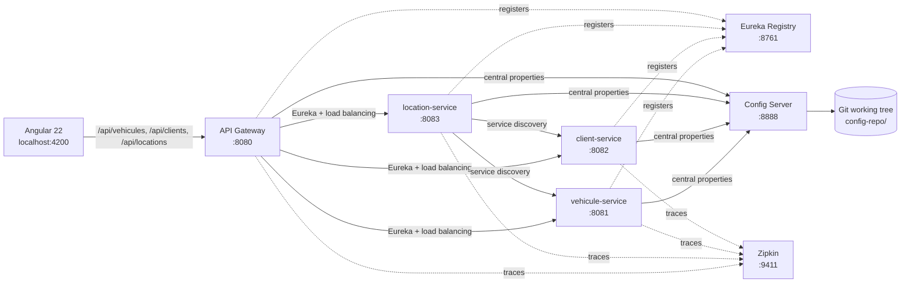

# DriveEasy architecture

Each business service owns a separate in-memory repository. The location service checks customer eligibility and vehicle availability through Eureka-discovered HTTP clients. Rental periods are authoritative in location-service; the vehicle service's date availability endpoint asks it for conflicting active reservations. No database is used; all in-memory business data resets when its owning service restarts.

The Config Server serves the `config-repo/` path from the backend Git repository. For local runs, start it with the backend directory as the working directory so its relative `file:.` URI resolves to this repository. Do not add passwords or tokens to the config repository.
